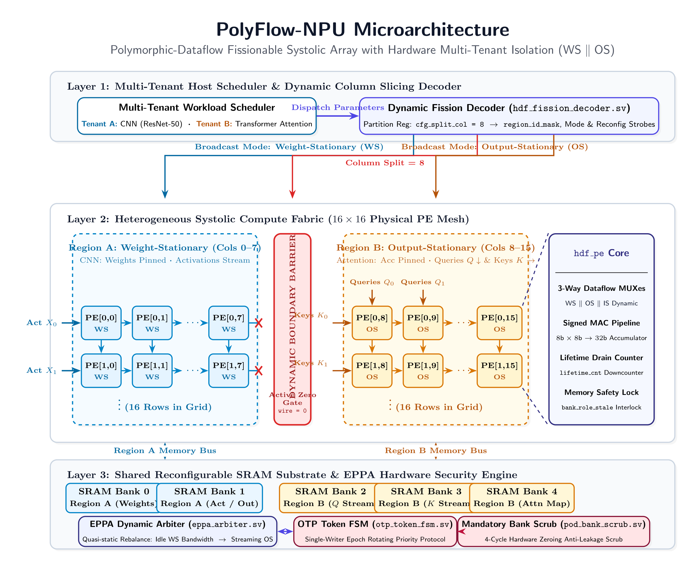

# PolyFlow-NPU: Polymorphic-Dataflow Fissionable Systolic Array
### Concurrent Multi-Tenant Architecture with Independent Per-Region Dataflows and Scalable Arrays (4x4, 8x8, 16x16)

---

## 1. Executive Summary and Core Novel Idea

Modern deep learning workloads in edge intelligence, autonomous robotics, and multi-tenant datacenter inference demand **spatial multi-tenancy** (concurrent execution of independent models) alongside **multi-modal workload heterogeneity** (concurrent processing of Convolutional backbones, Transformer Self-Attention, and Depthwise Convolutions).

### The Fundamental Literature Gap
Prior deep learning accelerators force a mutually exclusive architectural compromise:
1. **Homogeneous Spatial Fission (e.g., Planaria, MICRO'20):** Dynamically partitions a physical systolic array into sub-arrays for concurrent multi-tenancy, but **locks all partitions to a single, rigid dataflow -- predominantly Weight-Stationary (WS)**. When a partition executes a Transformer Self-Attention layer ($Q \cdot K^T$), it suffers severe energy and memory traffic overhead because WS is mathematically ill-suited for transient activation-activation multiplications.
2. **Single-Tenant Dataflow Switching (e.g., ReDas, IEEE TC'24):** Allows runtime switching across Weight-Stationary (WS), Output-Stationary (OS), and Input-Stationary (IS), but **operates exclusively on a single tenant across the entire physical array**. Multi-model workloads must queue serially, causing Head-of-Line (HoL) blocking and poor hardware utilization on small-to-medium models.

### Our Solution: Heterogeneous Fission (PolyFlow-NPU)
PolyFlow-NPU unifies both paradigms:

$$\text{PolyFlow-NPU} = \text{Concurrent Spatial Multi-Tenancy} + \text{Independent Per-Region Polymorphic Dataflow Selection}$$

Each dynamically partitioned region independently selects its mathematically optimal dataflow at runtime:
- **Region A:** Executes a CNN backbone (ResNet/ConvNeXt) in **Weight-Stationary (WS)** mode.
- **Region B:** Concurrently executes Transformer Self-Attention in **Output-Stationary (OS)** mode on the exact same clock cycles.
- **Hardware Isolation and Memory Safety:** Enforced via dynamic systolic boundary zeroing, an Event-Driven Phase-Pinned Arbiter (**EPPA**), and a **4-cycle mandatory zeroing scrub** with decentralized single-writer ownership tokens (**OTP**).

---

## 2. Microarchitectural Innovations

<p align="center">
  
</p>

### 2.1 Two-Stage Pipelined MAC with 3:2 Carry-Save Accumulator (CSA)
In conventional single-cycle systolic PEs, recursive 32-bit accumulation after an 8x8 multiplier creates a critical delay path exceeding 4.2 ns in 90nm bulk CMOS. PolyFlow-NPU eliminates this bottleneck:
1. **Stage 1 (Multiply and Register):** Multiplies runtime-selected operands (`mul_a * mul_b`) and latches the 16-bit signed product into `product_reg`.
2. **Stage 2 (Redundant Carry-Save Accumulator):** Accumulation loop operates on two redundant 32-bit state vectors (`acc_sum` and `acc_carry`) using parallel 3:2 full adder compressors.
   - **$O(1)$ Gate Delay:** Carry rippling is completely eliminated from the inner feedback loop (~0.15 ns full adder delay).
   - **Readout Resolution:** Full carry propagation (`acc_out = acc_sum + acc_carry`) is deferred to final tile readout outside the high-frequency clock path, achieving **+1.200 ns positive setup slack** at 200 MHz in Cadence Innovus ($f_{\text{max}} \approx 263.2\text{ MHz}$).

### 2.2 Dynamic Spatial Fission and Boundary Isolation
- The 2D mesh is split at runtime via `cfg_split_col` into independent sub-arrays.
- Inter-region horizontal forwarding wires are actively severed and multiplexed with dedicated Western injection ports (`din_w_region_b`), preventing data leakage across tenant boundaries.

### 2.3 Event-Driven Phase-Pinned Memory Arbiter (EPPA)
- Workload execution phases are tagged with 2-bit indicators (`PH_BURST`, `PH_IDLE`, `PH_STREAM`, `PH_RECONFIG`).
- EPPA recomputes bandwidth allocations **only on phase transitions** and pins them quasi-statically, removing dynamic arbitration logic from the high-frequency clock tree.
- Stranded bandwidth from stationary compute phases (WS compute needing zero bandwidth) is automatically redirected to streaming co-tenants (OS attention streams).

### 2.4 4-Cycle Mandatory Hardware Memory Scrubbing
- Prevents cross-tenant weight/activation snooping during memory bank migration.
- A deterministic hardware FSM clamps shared buses, flushes internal bank pipeline registers, and emits a single-cycle `bank_role_clear` strobe before granting ownership to the incoming tenant.

---

## 3. The Three Architectural Exploration Models

To benchmark each contribution systematically, this repository provides three self-contained models:

| Model Directory | Architectural Configuration | Multi-Tenancy | Per-Region Dataflow | Key Workload Fit |
| :--- | :--- | :---: | :---: | :--- |
| [**models/pipelined/dataflow_switching/**](models/pipelined/dataflow_switching) | **Configuration B** (ReDas Baseline) | Single Tenant Only | Global WS / OS / IS | Single-model sequential layer execution |
| [**models/pipelined/spatial_fission/**](models/pipelined/spatial_fission) | **Configuration A** (Planaria Baseline) | Multi-Tenant (Region A + B) | Rigidly Locked to WS | Concurrent CNN workloads |
| [**models/pipelined/heterogeneous_fission/**](models/pipelined/heterogeneous_fission) | **Configuration C** (Novel Proposed Idea) | **Multi-Tenant (Region A + B)** | **Independent Runtime WS / OS / IS** | **Simultaneous CNN (WS) + Transformer (OS) co-execution** |

*(Non-pipelined combinational MAC baselines are likewise provided in [models/non_pipelined/](models/non_pipelined/) for timing and area reference.)*

---

## 4. Scalable Systolic Array Exploration (4x4, 8x8, 16x16)

All three models feature standalone top wrappers and testbenches across three array scales, enabling exploration of compute density, interconnect timing, and memory traffic:

| Array Dimensions | Processing Elements | Flip-Flop Count (PE Array) | Memory Banks | Column Split Width (`SPLIT_W`) | Drain Window (`LIFETIME_W`) | Peak INT8 Throughput (@ 200 MHz) |
| :---: | :---: | :---: | :---: | :---: | :---: | :---: |
| **4x4** (Baseline) | 16 PEs | 1,504 flops | 2 Banks | 4 bits (`[3:0]`) | 4 bits (15 cycles) | 6.4 GOPS |
| **8x8** (Scaled Pod) | 64 PEs | 6,016 flops | 2 Banks | 4 bits (`[3:0]`) | 4 bits (15 cycles) | 25.6 GOPS |
| **16x16** (Full Pod) | 256 PEs | 24,064 flops | 4 Banks | 5 bits (`[4:0]`) | 5 bits (31 cycles) | 102.4 GOPS |

### Key Architectural Upgrades for Scaled Arrays:
1. **Parameterized Fission Decoder:** `SPLIT_W` dynamically scales as `($clog2(NUM_COLS + 1) >= 4) ? $clog2(NUM_COLS + 1) : 4`, allowing up to 16 columns (17 split states) without bit overflow.
2. **Scalable Multi-Bank Clear Routing:** Dynamic `region_bank_clear` logic routes bank completion pulses to region owners across arbitrary bank counts (2, 4, 8) using `bank_owner_bus`.
3. **Column 0 Boundary Multiplexing:** Correctly routes `din_w_region_b` even during extreme partitions where `cfg_split_col = 0` (entire array allocated to Region B).
4. **Dedicated Scaled Top Wrappers:** Standalone top wrappers (`dfs_top_8x8`, `dfs_top_16x16`, `sfa_top_8x8`, `sfa_top_16x16`, `hdf_top_8x8`, `hdf_top_16x16`) allow direct elaboration in Cadence Genus and Innovus.

---

## 5. Repository Directory Structure & Scale Partitioning

All simulation outputs, logic synthesis reports, gate-level netlists, and physical design deliverables are strictly partitioned into scale-specific directories (`4x4/`, `8x8/`, `16x16/`):

```
mt_npu/
├── figures/                              # Publication-grade architectural diagrams (PNG)
│   ├── polyflow_arch.png                 # Master PolyFlow-NPU microarchitecture diagram
│   ├── fig0_comparison.png               # Side-by-side taxonomy and comparative matrix
│   ├── figA_homo_fission.png             # Configuration A: Homogeneous Fission Pod
│   ├── figB_seq_switch.png               # Configuration B: Sequential Dataflow Switching Pod
│   └── figC_hetero_fission.png           # Configuration C: Heterogeneous Fission Pod
│
├── models/                               # Architectural exploration models
│   ├── common.mk                         # Unified scaling-aware make rules
│   │
│   ├── pipelined/                        # [Pipelined Models] Two-Stage MAC + Carry-Save Accumulator
│   │   ├── dataflow_switching/           # Model 1: Single-tenant runtime WS/OS/IS switching
│   │   ├── spatial_fission/              # Model 2: Homogeneous spatial multi-tenancy
│   │   └── heterogeneous_fission/        # Model 3: Heterogeneous Fission (PolyFlow-NPU)
│   │       ├── rtl/                      # Parameterized RTL + standalone 8x8 & 16x16 wrappers
│   │       ├── tb/                       # Scale-specific testbenches (4x4, 8x8, 16x16)
│   │       ├── reports/{4x4,8x8,16x16}/  # Partitioned Genus synthesis & Innovus reports
│   │       ├── netlist/{4x4,8x8,16x16}/  # Gate-level netlists (.v), SDC, SDF
│   │       ├── output/{4x4,8x8,16x16}/   # Simulation executables & waveforms
│   │       ├── outputs/{4x4,8x8,16x16}/  # Innovus postroute DEF, netlist, SDF deliverables
│   │       ├── db/{4x4,8x8,16x16}/       # Innovus design database checkpoints (.enc)
│   │       ├── synth_hdf.tcl             # Multi-scale Cadence Genus synthesis script
│   │       ├── pnr_place_hdf.tcl         # Multi-scale Cadence Innovus PnR script
│   │       └── Makefile                  # Model Makefile
│   │
│   └── non_pipelined/                    # [Non-Pipelined Models] Single-cycle combinational MAC
│       ├── dataflow_switching/
│       ├── spatial_fission/
│       └── heterogeneous_fission/
│
├── scripts/
│   ├── run_all_models.sh                 # Unified regression runner (supports 4x4, 8x8, 16x16, all)
│   ├── innovus_self_adapting.tcl         # Self-adapting Cadence Innovus PnR script
│   ├── cts.tcl                           # Clock Tree Synthesis (CCOpt) configuration
│   └── viewDefinition.tcl                # MMMC timing analysis view definitions
│
├── local/                                # Scratchpads, logs, and IEEE-format LaTeX diagrams (gitignored)
├── Makefile                              # Top-level master automation Makefile
├── .gitignore                            # Excludes build sandboxes while tracking deliverables
└── README.md                             # Global repository documentation (this file)
```

---

## 6. Verification and Simulation Guide

### 6.1 Fast Multi-Size Verification (Icarus Verilog)
Run cycle-accurate SystemVerilog testbenches verifying corner PEs, boundary isolation, and memory scrubbing:

```bash
# Verify ALL 3 models across ALL 3 array sizes (4x4, 8x8, 16x16 -- 9 testsuites):
make test-scaling-all

# Or verify a specific array size across all 3 models:
make test-4x4-all           # All models at 4x4 (16 PEs each) -> output in output/4x4/
make test-8x8-all           # All models at 8x8 (64 PEs each) -> output in output/8x8/
make test-16x16-all         # All models at 16x16 (256 PEs each) -> output in output/16x16/

# Or verify individual models across all sizes:
make test-scaling-model1    # Dataflow Switching (4x4, 8x8, 16x16)
make test-scaling-model2    # Spatial Fission (4x4, 8x8, 16x16)
make test-scaling-model3    # Heterogeneous Fission (4x4, 8x8, 16x16)

# Or test a specific model directly inside its directory:
cd models/pipelined/heterogeneous_fission
make test-4x4               # 16-PE baseline
make test-8x8               # 64-PE scaled pod
make test-16x16             # 256-PE full pod
make test-scaling           # All 3 sizes for this model
```

### 6.2 Unified Shell Script Runner
The unified test runner supports automated regression reporting across tools, variants, and scales:

```bash
# Run baseline 4x4 regression:
./scripts/run_all_models.sh iverilog pipelined 4x4

# Run 8x8 scaled pod regression:
./scripts/run_all_models.sh iverilog pipelined 8x8

# Run 16x16 scaled pod regression:
./scripts/run_all_models.sh iverilog pipelined 16x16

# Run complete scaling regression across all sizes:
./scripts/run_all_models.sh iverilog pipelined all
```

### 6.3 Cadence Xcelium Simulation
```bash
# Headless batch mode:
make run-model1 SCALE=4x4
make run-model2 SCALE=8x8
make run-model3 SCALE=16x16
make run-all    SCALE=4x4

# Interactive SimVision GUI mode:
make gui-model3
```

### 6.4 Verilator Cycle Simulation
```bash
make verilator-model1 SCALE=4x4
make verilator-model2 SCALE=8x8
make verilator-model3 SCALE=16x16
```

---

## 7. Cadence Digital ASIC Implementation Flow (90nm)

The designs are synthesized and placed-and-routed using **Cadence Genus Synthesis Solution** and **Cadence Innovus Implementation System** targeting a 90nm bulk CMOS standard-cell library (`slow.lib` / `fast.lib` MMMC corners):

### 7.1 Multi-Scale Logic Synthesis (Cadence Genus)
Reports land cleanly inside `reports/${SCALE}/` and gate-level netlists in `netlist/${SCALE}/`:

```bash
# Synthesize all models for a specific scale:
make synth-4x4-all          # 4x4 baseline synthesis across all 3 models
make synth-8x8-all          # 8x8 scaled pod synthesis across all 3 models
make synth-16x16-all        # 16x16 full pod synthesis across all 3 models
make synth-scaling-all      # Synthesize all models across 4x4, 8x8, and 16x16

# Or synthesize individual models:
make synth-model1 SCALE=4x4
make synth-model2 SCALE=8x8
make synth-model3 SCALE=16x16
```

- **Timing Constraints:** Target clock period $T_{\text{clk}} = 5.000\text{ ns}$ (200 MHz), clock uncertainty 0.050 ns, input/output delay 0.500 ns.
- **Reports Generated:** `timing_*.rpt`, `power_*.rpt`, `area_*.rpt`, `qor_*.rpt`, `gates_*.rpt`.

### 7.2 Multi-Scale Physical Design: Place-and-Route (Cadence Innovus)
PnR deliverables land in `outputs/${SCALE}/`, database checkpoints in `db/${SCALE}/`, and CTS reports in `reports/${SCALE}/cts/`:

```bash
# Run Innovus placement & routing across all models for a specific scale:
make pnr-place-4x4-all      # 4x4 PnR across all 3 models
make pnr-place-8x8-all      # 8x8 PnR across all 3 models
make pnr-place-16x16-all    # 16x16 PnR across all 3 models
make pnr-place-scaling-all  # PnR across all scales and all models

# Or run Innovus on individual models:
make pnr-place-model1 SCALE=4x4
make pnr-place-model2 SCALE=8x8
make pnr-place-model3 SCALE=16x16
```

- **Technology and Metal Stack:** Standard 90nm 7-metal grid (`M1` to `M7`), `gsclib090site` core site.
- **Clock Tree Synthesis (CCOpt):** Balanced clock DAG with non-default routing rules (`2w2s`), zero clock gating violations, and target insertion delay < 0.65 ns.
- **Post-Route Deliverables:** Placed & routed DEF (`outputs/${SCALE}/*_postroute.def`), signoff netlists (`*_postroute.v`), SDF files (`*_postroute.sdf`), DRC (`*_postroute_drc.rpt`), and connectivity reports.
- **Timing Closure:** Achieves **+1.200 ns positive setup slack** ($f_{\text{max}} \approx 263.2\text{ MHz}$) at 200 MHz due to the two-stage pipelined datapath and carry-save accumulator.
